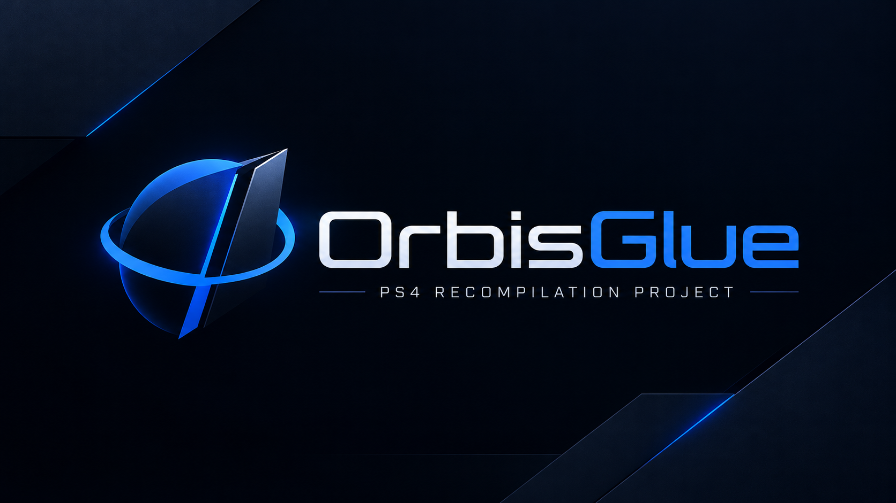

<!--
SPDX-FileCopyrightText: 2026 GenryTheFox, shadPS4 Emulator Project
SPDX-License-Identifier: GPL-2.0-or-later
-->

<p align="center"></p>

<p align="center">
  <b>PS4 games, recompiled.</b> Your own PS4 game's code, lifted to C and built into a native Windows program.<br>
  <a href="#english">English</a> · <a href="#русский">Русский</a> · <a href="../../wiki">Wiki</a> · <a href="https://t.me/teamgenrythefox">Telegram</a>
</p>

---

## English

**OrbisGlue** turns a PS4 game you own into a native Windows program. Its recompiler, **Mosaic**,
lifts the game's x86-64 machine code to C, function by function, and builds the C into a DLL; the
OrbisGlue runtime (a fork of [shadPS4](https://github.com/shadps4-emu/shadPS4)) then plays the game
on that code.

Why "Mosaic": a function that cannot be lifted yet simply stays the original machine code (the PS4
and the PC speak the same instruction set), so the game runs whole at every stage, lifted piece by
piece. And every lifted function can be **proven** against the original: the difftest runs both on
the same inputs and compares registers, flags, the stack and every byte of memory they touched.

### Where it is

| | |
|---|---|
| **Deadpool** (CUSA03528) | **123,375 of 123,409 functions lifted (99.98%)**. The game plays on the lifted code: menus, the first level, saves. 30 FPS — the game's own cap, same as the original. |
| What stays original | 30 functions (MMX leftovers, `rdtsc`, `cpuid`), the system libraries (shadPS4's HLE) and callbacks the system makes into the game. |
| Platform | Windows 10/11 x64, Vulkan GPU. Android is next — see [Roadmap](#roadmap). |

This is an early release. Deadpool is the only game taken all the way so far; the recompiler itself
is not specific to it (it reads any PS4 `eboot.bin` shadPS4 can load), but other games are untested.

### Quick start

You need: Python 3.10+ (`pip install capstone`), [LLVM](https://github.com/llvm/llvm-project/releases)
(clang-cl, lld-link), Visual Studio Build Tools with the C++ workload, and **your own dumped game**
(a folder with `eboot.bin` — see [Getting the game](../../wiki/Getting-the-game)).

```
python tools/mosaic/mosaic.py "D:\Games\CUSA03528" --play
```

That lifts the game to C (`<game>\_mosaic`), builds `mosaic.dll` and starts it:
`OrbisGlue.exe --orbisglue-mosaic <game>\_mosaic\mosaic.dll -g <game>\eboot.bin`.
Add `--difftest` to prove the lifted functions first (takes hours). Details in the [wiki](../../wiki).

### How it works

1. **Lift** (`tools/mosaic/lift64.py`): functions come from `.eh_frame`; each is decoded by following
   its control flow (switch tables found by pattern, no-return calls detected), and lifted whole or
   not at all. Registers, flags and the guest stack live in a context; memory is the host's.
2. **Build** (`build_mosaic.py`): clang-cl turns the C into a DLL. Addresses are relative to wherever
   the loader put the game, so nothing is pinned.
3. **Run** (`--orbisglue-mosaic`): the main thread and every thread the game starts enter lifted code.
   Calls to anything not lifted go to the original code through a small bridge on the guest stack.
4. **Prove** (`--orbisglue-difftest`): native vs. lifted on random but plausible inputs, writes tracked
   page by page, a function that differs from itself (clock, counters) set aside as non-deterministic.

### Not the first — and how it differs

PS4 recompilers exist: [bloodborne-recomp](https://github.com/bloodborne-native/bloodborne-recomp)
(Bloodborne to C, macOS/arm64) and [PS4Recomp](https://github.com/wie-project/PS4Recomp) (ahead-of-time
to arm64 assembly, macOS). OrbisGlue is a game-agnostic recompiler for Windows that emits C, runs a
game whole while it is being lifted, and proves the lifted functions against the originals.

### Roadmap

- **Android (ARM64)** — the main goal. The lifted C already compiles for phones (x86 SIMD through
  SIMDe); next is the runtime on Android and the GPU path for Mali as well as Adreno. Lifted ahead of
  time: no JIT on the phone.
- The proof run over all lifted Deadpool functions, and 100% lifting.
- Speed: optimised builds, dropping flag work nobody reads.
- A shader cache against first-time stutter.
- More games; the GenryPS4 launcher gets a "Recompile" button.

### Credits and license

OrbisGlue is built on **shadPS4** (from commit `615bcba`) and keeps its license, **GPL-2.0-or-later** —
thank you to the shadPS4 team and contributors ([their README](documents/shadPS4-README.md)). Mosaic uses
[Capstone](https://github.com/capstone-engine/capstone), [Xbyak](https://github.com/herumi/xbyak) and,
for ARM, [SIMDe](https://github.com/simd-everywhere/simde).

Made by **GenryTheFox**; the code is written together with Shram, an AI (Claude). No game code,
files or art are part of this project, and the C lifted from your game is yours to keep, not to
share. Not affiliated with Sony Interactive Entertainment. Contact: [Telegram](https://t.me/teamgenrythefox).

---

## Русский

**OrbisGlue** превращает твою PS4-игру в обычную программу для Windows. Его рекомпилятор **Mosaic**
переводит машинный код игры (x86-64) в C, функцию за функцией, и собирает из него DLL, а рантайм
OrbisGlue (форк [shadPS4](https://github.com/shadps4-emu/shadPS4)) запускает игру на этом коде.

Почему «мозаика»: функция, которую ещё не удалось перевести, просто остаётся родным машинным кодом
(у PS4 и ПК один процессорный язык) — игра работает целиком на каждом этапе, а переводится по
кусочкам. И каждую переведённую функцию можно **доказать**: стенд гоняет оригинал и перевод на одних
входах и сравнивает регистры, флаги, стек и каждый тронутый байт памяти.

### Где мы сейчас

- **Deadpool (CUSA03528): переведено 123 375 из 123 409 функций (99,98 %).** Игра идёт на
  переведённом коде: меню, первый уровень, сохранения; 30 FPS — потолок самой игры, как в оригинале.
- Оригиналом остаются 30 функций (MMX, `rdtsc`, `cpuid`), системные библиотеки (HLE shadPS4) и
  обратные вызовы системы в игру.
- Пока Windows 10/11 x64 и видеокарта с Vulkan. Дальше — Андроид.

Это ранний выпуск: до конца пройден пока один Дэдпул. Сам переводчик под конкретную игру не заточен
(берёт любой `eboot.bin`, который грузит shadPS4), но другие игры ещё не проверялись.

### Быстрый старт

Нужно: Python 3.10+ (`pip install capstone`), LLVM (clang-cl, lld-link), Visual Studio Build Tools
с C++ и **свой дамп игры** — папка с `eboot.bin` (см. вики «[Откуда взять игру](../../wiki/Getting-the-game)»).

```
python tools/mosaic/mosaic.py "D:\Games\CUSA03528" --play
```

Команда переводит игру в C (`<игра>\_mosaic`), собирает `mosaic.dll` и запускает. `--difftest` —
сначала доказать переведённые функции (это часы). Подробности — в [вики](../../wiki).

### Что готовится

- **Андроид (ARM64)** — главная цель. Переведённый C уже собирается под телефон (SIMD через SIMDe);
  дальше — рантайм на Андроиде и графика не только для Adreno, но и для Mali. Перевод заранее —
  никакого JIT на телефоне.
- Полная проверка всех функций Дэдпула и 100 % перевода.
- Скорость: оптимизированная сборка, выкидывание лишней работы с флагами.
- Кэш шейдеров против подвисаний при первой встрече эффекта.
- Новые игры; кнопка «Перевести» в лаунчере GenryPS4.

### Благодарности и лицензия

OrbisGlue сделан на основе **shadPS4** (с коммита `615bcba`), лицензия та же: **GPL-2.0-or-later**. Спасибо команде shadPS4. Код
пишется вместе со Шрамом — это ИИ (Claude). Никакого кода, файлов и арта игр в проекте нет; C,
переведённый из твоей игры, — для тебя, не для раздачи. Связь — [Telegram](https://t.me/teamgenrythefox).
